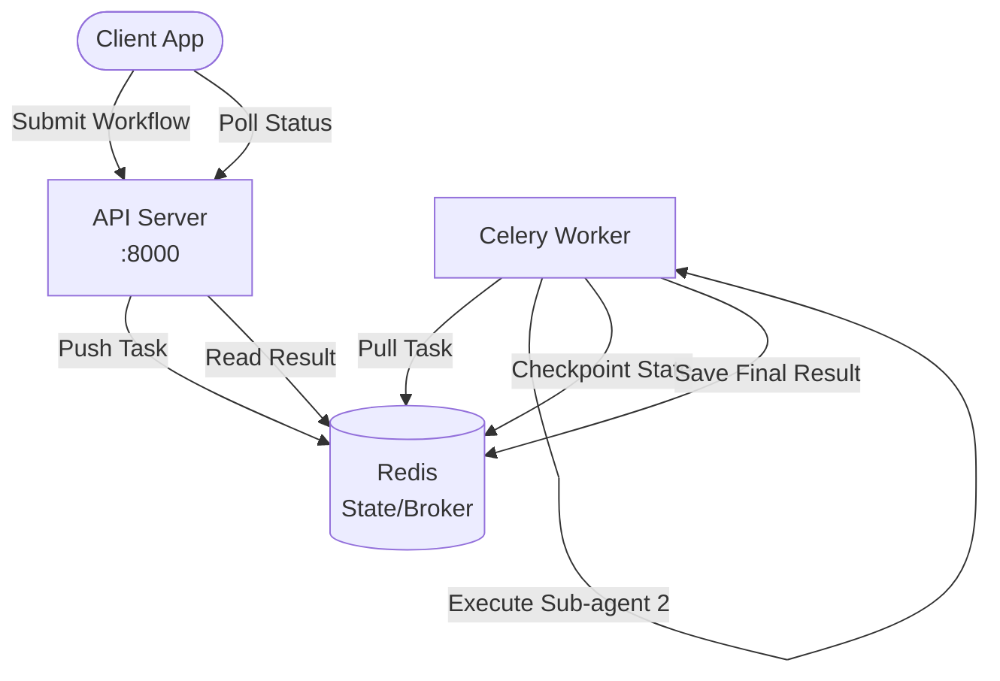
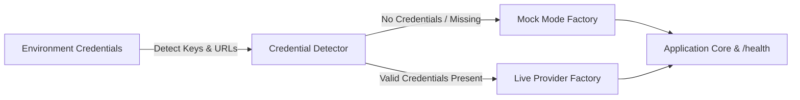

# Architecture — agent-orchestration-system
> Last updated: 2026-08-29 | Maturity: Partial Prototype
> _Durable execution of multi-agent workflows._

## System Diagram

## Component Table
| Component | File | Responsibility | Tech |
|---|---|---|---|
| API Server | `server/main.py` | Receives workflows, polls status | FastAPI |
| Celery Worker | `server/worker.py` | Executes agent steps | Celery |
| Broker/Backend | `docker-compose.yml` | Message broker and result backend | Redis |

## Dependency Honesty Table
| Dependency | Status | Notes |
|---|---|---|
| Redis | **Real** | Used for both Celery message broker and durable state checkpoints. |
| Sub-Agents | **Mocked** | Sleep-and-return logic used to simulate long-running LLM calls. |

## Progressive Credential Loading & Production Architecture (v0.2.0)

This service implements the **Progressive Credential Loading (PCL)** pattern, decoupling development speed from external infrastructure provisioning:

### Core Architecture Components
1. **Mode Detection Singleton:** Inspects environment configuration at boot time without hard crashes on missing secrets.
2. **Dual-Mode Factory Wrappers:**
   - **Storage / Cache:** In-process maps or SQLite `:memory:` transparently promote to managed Redis or PostgreSQL when connection strings are supplied.
   - **AI Providers:** Deterministic heuristic generators and local embeddings transparently promote to live OpenAI, Anthropic, or Gemini API clients.
3. **Hot-Reload & Dynamic TLS:** File watchers monitor mounted volume paths (Kubernetes ConfigMaps and Secrets) to update certificates and limit configs atomically without process restarts.
4. **Health & Observability:** The `/health` endpoint exposes real-time runtime mode metadata (`mock` vs `live`) across all backing adapters.
